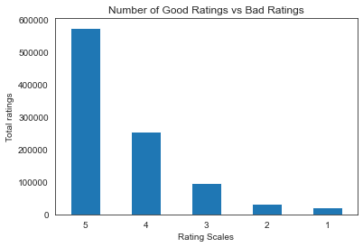

# Amazon Kindle Store Review Sentiment Analysis

## Project Overview
This project explores customer reviews from the Amazon Kindle Store using Python, natural language processing (NLP), and machine learning. The aim is to classify reviews as positive or negative based on their ratings and text.

## Business Problem
Customer reviews provide valuable information about customer satisfaction. Analysing large volumes of reviews can help identify positive experiences, negative feedback, and potential areas for improvement.

## Objectives
- Clean and prepare review text for analysis.
- Explore customer review ratings and sentiment.
- Convert text into numerical features using CountVectorizer and TF-IDF.
- Train and evaluate machine learning models for sentiment classification.
- Compare model performance using appropriate evaluation metrics.

## Dataset
The project report describes a dataset of approximately 982,619 Amazon Kindle Store reviews from 2000 to 2014.

Sentiment labels were created from review ratings:
- **Positive:** ratings of 3–5
- **Negative:** ratings of 1–2

The dataset is referenced in the original project report. Please see the report or notebook for the original source and data details.

## Tools and Technologies
- Python
- Jupyter Notebook
- Pandas and NumPy
- Natural Language Processing (NLP)
- Scikit-learn
- CountVectorizer and TF-IDF
- Matplotlib and Seaborn, where used in the notebook

## Methodology
1. Load and explore the review dataset.
2. Clean the review text, including lowercasing and removing punctuation and stop words.
3. Apply text preprocessing and lemmatisation.
4. Convert review text into numerical features.
5. Train machine learning models, including Naive Bayes, Logistic Regression, Support Vector Classifier, and Random Forest, as implemented in the notebook.
6. Evaluate model performance using metrics such as accuracy, precision, and ROC-AUC, where available.

## Results
The original report records an initial Naive Bayes accuracy of approximately 91% and a tuned test accuracy of approximately 87%.

These figures are reported at different stages of the project and should be interpreted in the context of the evaluation method and class imbalance. Please consult the notebook for the corresponding model outputs.

## Limitations
- The dataset contains substantially more positive reviews than negative reviews, which may affect model performance.
- Accuracy alone may not fully reflect how well the model identifies negative reviews.
- Results depend on the dataset, preprocessing decisions, and model configuration.

## Future Improvements
- Evaluate models using precision, recall, F1-score, and confusion matrices.
- Investigate methods for handling class imbalance.
- Compare additional NLP techniques and model configurations.
- Improve reproducibility by documenting the environment and dependencies.

## Repository Contents
- `sentiment_analysis.ipynb` — Python notebook containing the project analysis.

## How to Run
1. Download or clone this repository.
2. Install the required Python libraries.
3. Open the notebook using Jupyter Notebook or JupyterLab.
4. Run the notebook cells in order.

**Note:** The dataset may need to be downloaded separately. Refer to the original dataset source identified in the project materials.

## Project Visualisation

The chart below highlights one of the visual insights from the Amazon Kindle Store review sentiment analysis.

## Project Background
This project was completed in January 2023. When reusing or adapting code or data from external sources, please acknowledge the relevant original sources.

## Project Documentation

You can explore the project documentation below:

- [Project Report (PDF)](reports/project_report.pdf)
- [Project Presentation (PDF)](reports/project_presentation.pdf)

## Author

Created as a data science project exploring sentiment analysis, natural language processing, and machine learning using Python.

